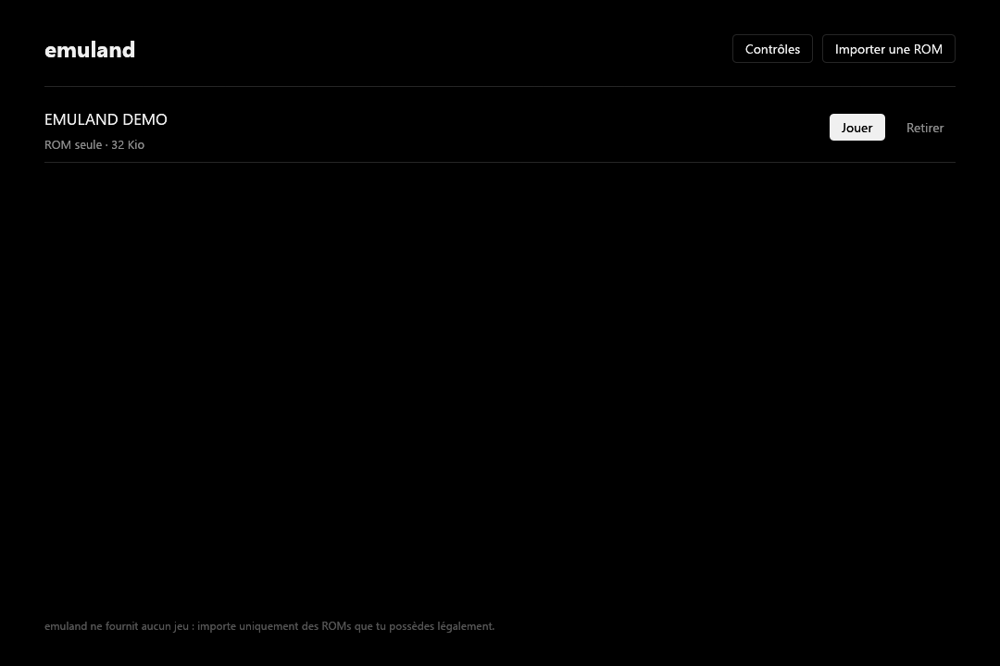
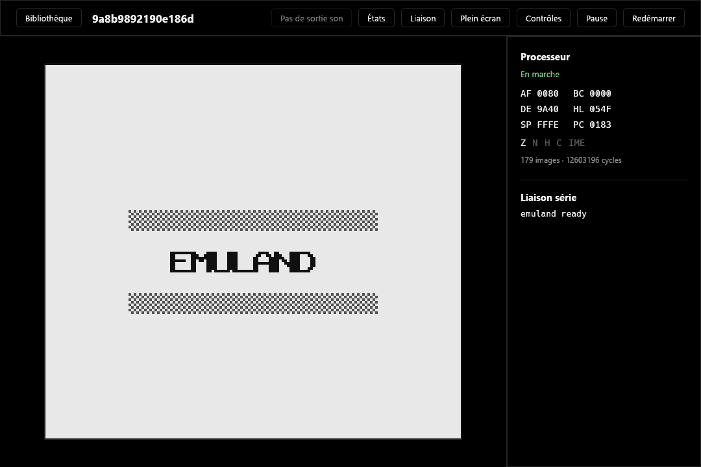
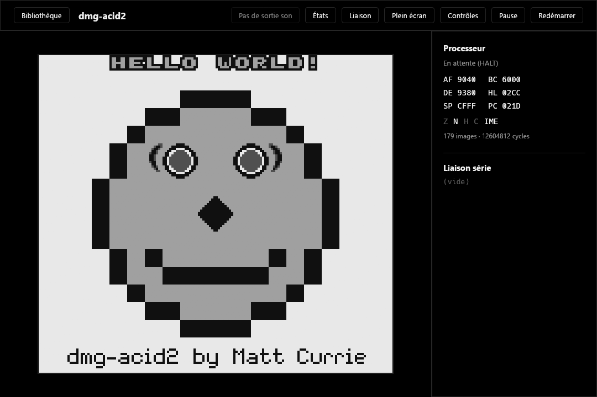
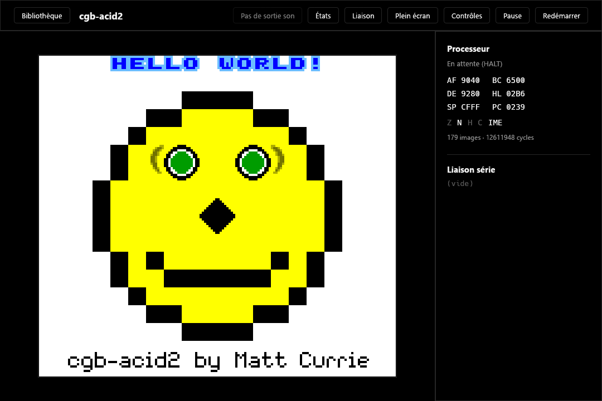
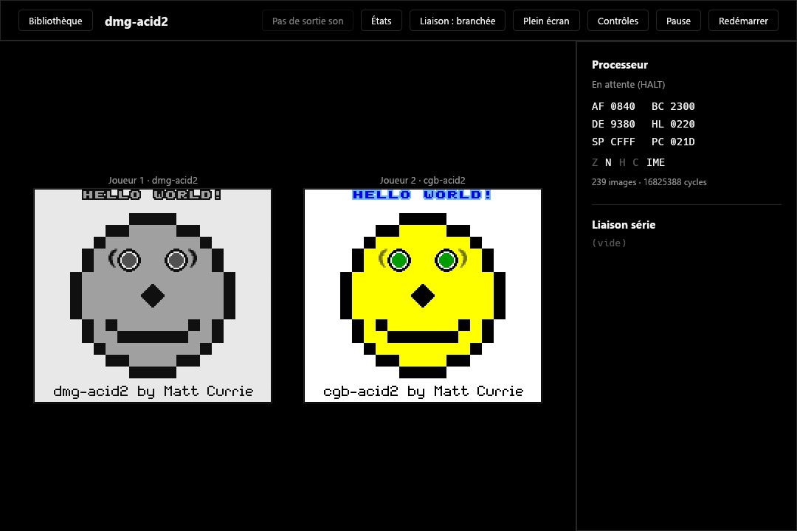

# emuland

A **Game Boy and Game Boy Color emulator** written in Rust, with its own desktop front end.
No dependency on another emulator: the CPU, the screen (PPU), the sound (APU), the timer, the cartridges and the link cable
are all written from scratch and checked against the community's reference test ROMs.

> The interface is in French. The emulator core (`gb-core`) is independent of it and can be used as a library.

<p align="center">
  
  
</p>
<p align="center">
  
  
</p>
<p align="center">
  
</p>

## Features

**Emulation**
- Game Boy (DMG) and Game Boy Color (CGB): colours, two VRAM banks, eight WRAM banks, colour palettes, HDMA, double speed.
- CPU stepped **one machine cycle at a time**, so reads and writes happen at the right moment inside an instruction.
- PPU with background, window and sprites (10 per line, correct priorities), VRAM/OAM locked by mode, STAT interrupts, OAM DMA timing.
- Four-channel sound (two square waves with sweep, wave, noise) with the frame sequencer, envelopes and length counters.
- Timer with the `DIV`/`TIMA` edge behaviour and delayed reload, `HALT` bug, `STOP`, interrupt dispatch timing.
- Cartridges: ROM only, MBC1 (including 1 MiB multicarts), MBC2, MBC3 (with a **real-time clock** that keeps running while the emulator is closed),
  MBC5, MBC7 (accelerometer + EEPROM), HuC1, HuC3 (without its clock), Pocket Camera.
- **Link cable** between two consoles running side by side (serial port at 8 192 Hz, internal or external clock).

**Front end**
- Library of imported ROMs, drag and drop, battery saves, **four save-state slots per game** (`F5` / `F8`), full screen (`F11`).
- Keyboard and mouse bindings you can change; a second set of keys for player 2.
- Mouse position tilts the console for accelerometer games.
- Sound output through the default audio device; mute button.
- Register panel and serial console to follow what a ROM is doing.

## Accuracy

54 test ROMs are run by the test suite; **44 pass**. Pixel-exact results on both acid tests.

| Test | Result |
|---|---|
| Blargg `cpu_instrs` (11 ROMs) | all pass |
| Blargg `instr_timing`, `mem_timing`, `mem_timing-2`, `halt_bug` | all pass |
| Blargg `interrupt_time` (CGB, double speed) | pass |
| [dmg-acid2](https://github.com/mattcurrie/dmg-acid2) and [cgb-acid2](https://github.com/mattcurrie/cgb-acid2) | identical to the reference image, pixel for pixel |
| Blargg `dmg_sound` | 9 / 12 |
| Blargg `cgb_sound` | 11 / 12 |
| Blargg `oam_bug` | 2 / 8 |

Known gaps: wave RAM access while the channel is playing (4 sound tests), the DMG OAM corruption bug (6 tests), variable-length drawing
mode in the PPU (lines are drawn in one go with the registers as they are at the end of the line). MBC6, MMM01 and TAMA5 cartridges are
detected but not supported.

## Getting started

**Download** a build from the *Releases* page, or build it yourself (Rust 1.85 or newer):

```bash
cargo run --release -p emuland
```

Then import your own ROM files (`.gb`, `.gbc`) with the *Importer une ROM* button or by dropping them on the window.
A tiny demo ROM written for this project is built in (*Essayer la ROM de démonstration*).

**This repository contains no game and no boot ROM.** Only use dumps of cartridges you own.

### Controls

| Game Boy | Keyboard (default) | Alternative |
|---|---|---|
| D-pad | `Z` `Q` `S` `D` | arrow keys |
| A / B | `L` / `K` | `X` / `C`, left / right mouse click on the screen |
| Start / Select | `Enter` / `Backspace` | `P` / `O` |
| Save / load state | `F5` / `F8` | *États* menu |
| Full screen | `F11` (`Esc` to leave) | button |

Everything can be rebound in the *Controls* window. The interface is available in English and French (*Language* menu; the default follows your Windows language). In link mode, player 2 uses the arrow keys, `M` (A), `N` (B), `J` (Start) and `H` (Select).

Saves, states and settings live in `%APPDATA%\emuland`.

### Command-line test mode

`emuland --test <rom>` opens the window **off screen, without taking focus**, plays scripted button presses, takes screenshots of itself and exits.
It is how the screenshots above were made, and it lets you check the interface without touching the keyboard or the mouse:

```bash
emuland --test game.gb --keys "start@3,a@5+0.3" --act "save@7,load@11" --shot "8:capture.bmp"
emuland --test a.gb --link b.gbc --keys2 "start@4" --shot "6:link.bmp"      # two consoles on a link cable
emuland --test-menu --shot "5:menu.bmp"                                      # the library (use a throw-away APPDATA)
```

## Layout

```
gb-core/    the emulator, with no graphics or audio dependency
  src/cpu.rs  bus.rs  mmu.rs  ppu.rs  apu.rs  timer.rs  joypad.rs  cartridge.rs  state.rs  link.rs  gameboy.rs
  tests/      accuracy test ROMs, save states
emuland/    the desktop application (egui + cpal)
scripts/    fetch-test-roms.sh / .ps1
docs/       screenshots
```

## Tests

```bash
cargo test --release                       # unit tests and save-state tests
scripts/fetch-test-roms.sh                 # or scripts\fetch-test-roms.ps1 on Windows
cargo test --release -p gb-core --test blargg -- --ignored    # the 44 reference ROMs
```

## Credits

The reference ROMs are not mine and are not redistributed here; the script downloads them from their authors:
Shay Green (Blargg) test ROMs via [retrio/gb-test-roms](https://github.com/retrio/gb-test-roms), and
[dmg-acid2 / cgb-acid2](https://github.com/mattcurrie/dmg-acid2) by Matt Currie. Their reference images are used for the pixel comparison.
Game Boy documentation from the [Pan Docs](https://gbdev.io/pandocs/) community was invaluable.

*Game Boy* and *Game Boy Color* are trademarks of Nintendo. emuland is not affiliated with or endorsed by Nintendo.

## License

[MIT](LICENSE)
